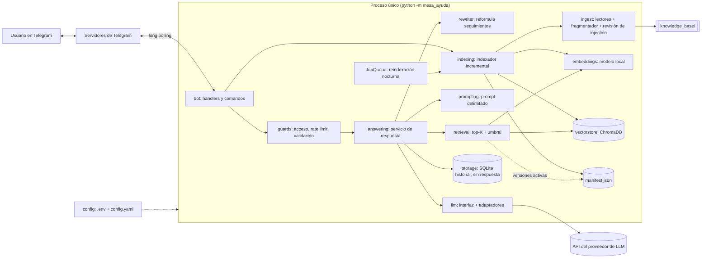

# Plan de implementación: Asistente de mesa de ayuda con RAG en Telegram

**Rama**: `main` | **Fecha**: 2026-11-06 | **Spec**: [spec.md](spec.md)

**Entrada**: especificación de la funcionalidad en `specs/spec.md`

> Generado con GitHub Spec Kit (`/speckit-plan`, plantilla `plan-template` traducida).
> Este plan describe **cómo** se construye el sistema y referencia los requisitos del spec.
> Los artefactos de soporte son: [research.md](research.md) (alternativas evaluadas),
> [data-model.md](data-model.md) (modelo de datos detallado), [contracts/](contracts/)
> (interfaces internas, comandos y configuración) y [quickstart.md](quickstart.md)
> (escenarios de validación de punta a punta).

## Resumen

Un único proceso en Python atiende Telegram por *long polling* (S-06). Al arrancar, y con
`/reindex` o con la tarea nocturna, indexa de forma incremental la carpeta
`knowledge_base/`: lee cada formato, fragmenta por sección y tamaño, calcula embeddings con
un modelo **local** multilingüe y guarda los fragmentos en **ChromaDB persistente en disco**.
Cada pregunta pasa por control de acceso, límite de mensajes y validación; se reformula con
el historial si es de seguimiento, se recuperan los *top-K* fragmentos y, **solo si alguno
supera el umbral**, se construye un prompt delimitado y se llama al LLM elegido por
configuración (Anthropic por defecto, OpenAI y APIs compatibles, Gemini opcional). El código,
no el modelo, agrega las citas. El historial y las preguntas sin respuesta viven en
**SQLite**. La capa RAG es propia (unas pocas centenas de líneas), sin LangChain ni
LlamaIndex, para poder probar y documentar el prompt final (ver research.md, R-02).

## Contexto técnico

**Lenguaje/Versión**: Python >= 3.11 (desarrollado y probado en 3.11.9).

**Dependencias principales**:

| Uso | Librería | Versión de referencia (PyPI, 2026-11-06) |
|---|---|---|
| Telegram (async, polling, JobQueue) | `python-telegram-bot[job-queue]` | 22.8 |
| Índice vectorial local | `chromadb` | 1.5.9 |
| Embeddings locales | `fastembed` (ONNX Runtime, sin torch) | 0.9.1 |
| PDF (texto por página) | `pypdf` | 7.0.0 |
| DOCX | `python-docx` | 1.2.0 |
| Configuración tipada | `pydantic-settings` + `PyYAML` | 2.16.2 |
| Logs estructurados | `structlog` | 26.1.0 |
| LLM Anthropic | `anthropic` | 2.6.0 |
| LLM OpenAI y compatibles | `openai` | 3.46.0 |
| LLM Gemini | `google-genai` | 3.0.0 |
| Calidad | `pytest`, `ruff`, `mypy` | 9.2.0, 0.17.4, 2.4.1 |

Las versiones exactas se fijan en `pyproject.toml` en T-01 y se registran si cambian.

**Almacenamiento**: ChromaDB persistente en `data/chroma/` (fragmentos y embeddings),
manifest JSON en `data/manifest.json` (estado de indexación), SQLite en `data/bot.sqlite3`
(historial y preguntas sin respuesta). Todo `data/` está en `.gitignore` y se regenera.

**Pruebas**: `pytest` con proveedor de LLM falso y embedder falso determinista; sin red ni
API keys (constitución, principio V). Evaluación de calidad con `scripts/evaluate.py`.

**Plataforma objetivo**: equipo del evaluador (Windows, macOS o Linux) o contenedor Docker.

**Tipo de proyecto**: aplicación de un solo proceso (bot), proyecto único.

**Metas de desempeño**: respuesta típica < 10 s (SC-005); reindexar un documento de hasta
50 páginas < 1 min en CPU (SC-006).

**Restricciones**: sin servicios en la nube salvo la API del LLM (CA-R2.3); embeddings en
CPU; ejecución con máximo 4 comandos (CA-R2.1); un solo proceso escribe el índice.

**Escala/alcance**: decenas de documentos y pocos usuarios simultáneos (S-07).

## Verificación de la constitución

*COMPUERTA: debe pasar antes de la fase 0 y se revisa de nuevo después de la fase 1.*

| Principio | Cómo lo cumple el plan | Estado |
|---|---|---|
| I. Especificación antes que código | spec, plan y tareas se versionan antes de `src/`; cada tarea referencia un RF/RNF | ✅ |
| II. Respuestas fundamentadas o ninguna | Rechazo por umbral antes del LLM, marcador `NO_ENCONTRADO`, citas generadas por el código | ✅ |
| III. Configurable, secretos fuera | `.env` solo secretos, `config.yaml` el resto, validación al arrancar, prompt en archivo | ✅ |
| IV. Menos cosas, bien hechas | Fases por prioridad O → D → P; RAG propio en vez de framework | ✅ |
| V. Pruebas sin red | Dobles de LLM y embedder; commit solo con pytest + ruff + mypy en verde | ✅ |
| VI. Observabilidad sin secretos | structlog JSON con redacción de secretos; pregunta solo en DEBUG | ✅ |
| VII. Solo texto | Sin herramientas para el modelo; contexto delimitado; texto plano | ✅ |

Revisión después del diseño (fase 1): sin violaciones. La única complejidad adicional
(cambio de versión por documento y candado de reindexación) está justificada por CA-08.4 y
CA-09.2; ver [Seguimiento de complejidad](#seguimiento-de-complejidad).

## Arquitectura



### Componentes y responsabilidades

| Módulo (`src/mesa_ayuda/`) | Responsabilidad | Requisitos |
|---|---|---|
| `config.py` | Carga y valida `.env` + `config.yaml`; variables de entorno sobrescriben YAML | RNF-01 |
| `logging_setup.py` | structlog JSON, ID de solicitud, filtro que redacta secretos | RNF-03, RNF-06 |
| `ingest/loaders.py` | Un lector por formato → lista de `Section` (texto, sección, página) | RF-01 |
| `ingest/discovery.py` | Recorre la carpeta, filtra ocultos, `~$*`, extensiones no soportadas | RF-01 |
| `ingest/chunker.py` | Corta por sección → párrafo → línea → oración → palabra → caracteres, con solapamiento | RF-02 |
| `ingest/injection_check.py` | Patrones de manipulación sobre el texto extraído | RF-13 |
| `embeddings.py` | Interfaz `Embedder`; implementación local e5 con prefijos `query:`/`passage:` | RF-02 |
| `vectorstore.py` | Envoltura de Chroma (coseno), filtro por versiones activas | RF-02, RF-09 |
| `indexing/manifest.py` | Lectura/escritura atómica del manifest; cálculo de diferencias | RF-09 |
| `indexing/indexer.py` | Orquesta la reindexación incremental o completa, candado, resumen | RF-08, RF-09, RF-11 |
| `retrieval.py` | Embedding de la pregunta, top-K, umbral | RF-03, RF-04 |
| `rewriter.py` | Convierte un seguimiento en pregunta autónoma usando el historial | RF-05 |
| `prompting.py` | Ensambla prompt de sistema + fragmentos numerados delimitados + historial + pregunta | RF-03, RNF-04 |
| `llm/base.py`, `llm/anthropic.py`, `llm/openai.py`, `llm/gemini.py`, `llm/fake.py` | Interfaz `LLMProvider`, adaptadores, timeout, reintentos, errores unificados | RNF-01, RNF-05 |
| `answering.py` | Flujo de una pregunta: rechazo previo, llamada, `NO_ENCONTRADO`, citas | RF-03, RF-04, RF-10 |
| `storage.py` | SQLite: historial por usuario con límite, preguntas sin respuesta | RF-05, RF-10 |
| `guards.py` | Control de acceso, límite por minuto (memoria), validación de mensaje | RF-07, RNF-05 |
| `bot/handlers.py`, `bot/messages.py` | Comandos, manejador de texto y no texto, división en 4096, "escribiendo…", textos del bot | RF-06, RF-08, RNF-05 |
| `__main__.py` | Arranque: config → logs → indexación inicial → polling → tarea nocturna | RNF-02, RF-11 |

## Flujo de ingesta (RF-01, RF-02, RF-09)

1. `discovery` lista los archivos soportados de `KNOWLEDGE_BASE_PATH` (recursivo) y calcula
   la huella **SHA-256** de cada uno.
2. `manifest.diff` compara con el manifest: **nuevo**, **cambiado**, **sin cambios**,
   **eliminado** (un renombre aparece como eliminado + nuevo). Si los ajustes de
   fragmentación o el modelo de embeddings difieren de los guardados en el manifest, o el
   manifest/índice no existe o está corrupto, todo se marca para **reconstrucción completa**.
3. Para cada archivo nuevo o cambiado, en un hilo aparte (`asyncio.to_thread`, para no
   bloquear el *event loop*):
   1. `loaders` extrae secciones (Markdown por encabezados, DOCX por estilos de título, PDF
      por página, TXT completo con respaldo de codificación UTF-8 → cp1252).
   2. Sin texto extraíble o error del lector → **ilegible**: si había versión anterior, se
      retira (CA-09.6); se registra y se agrega al resumen.
   3. `chunker` fragmenta; `injection_check` revisa cada fragmento según el modo (RF-13).
   4. `embeddings` calcula vectores con prefijo `passage:`.
   5. `vectorstore` agrega los fragmentos con `doc_key = "<ruta>@<versión nueva>"`.
   6. **Cambio de versión**: se actualiza en memoria y en disco (escritura atómica) la
      versión activa del documento; desde ese instante las consultas filtran por la nueva.
   7. Se borran los fragmentos de la versión anterior.
4. Para cada eliminado: se quita de las versiones activas y luego se borran sus fragmentos.
5. Se devuelve el `ReindexSummary` (nuevos, actualizados, eliminados, sin cambios,
   ilegibles, sospechosos, duración).

Un `threading.Lock` no bloqueante garantiza una sola reindexación a la vez (CA-08.5,
CA-11.2). En la reconstrucción completa se construye una colección nueva y se cambia el
puntero de colección al final (ver research.md, R-09).

## Flujo de una pregunta (RF-03, RF-04, RF-05, RF-07, RNF-04, RNF-05)

1. Llega un `Update`. Si el chat no es privado → se ignora (CA-07.4).
2. **Acceso**: usuario fuera de `ALLOWED_USER_IDS ∪ ADMIN_USER_IDS` → mensaje de acceso
   denegado con su ID; log `outcome=denied` (CA-07.2).
3. **Límite de mensajes**: ventana deslizante de 60 s en memoria; exceso → aviso (CA-R5.4).
4. **Validación**: no texto o texto vacío → mensaje "solo texto" con la sugerencia de
   dictado (CA-R5.3).
5. Se envía `typing` y se carga el historial del usuario (últimos `HISTORY_LENGTH`).
6. **Reformulación** (solo si hay historial): una llamada corta al LLM convierte "¿y se
   pueden acumular?" en "¿Las vacaciones se pueden acumular?". Si falla, se usa la pregunta
   original concatenada con la última pregunta del usuario (degradación aceptable).
7. **Recuperación**: embedding con prefijo `query:`, búsqueda top-K en Chroma filtrando
   `doc_key ∈ versiones activas`, conversión de distancia coseno a similitud
   (`1 − distancia`) y filtro por `SIMILARITY_THRESHOLD`.
8. **Rechazo previo**: ningún fragmento pasa el umbral → respuesta "no encontrado", registro
   en `unanswered`, **sin llamar al LLM** (CA-04.1).
9. **Prompt final** (ver [contracts/prompt.md](contracts/prompt.md)):
   - *system*: contenido de `SYSTEM_PROMPT_PATH` (reglas de fundamentación, datos ≠
     instrucciones, formato accesible, protocolo de citas y `NO_ENCONTRADO`).
   - *historial*: últimos turnos usuario/asistente, sin las citas.
   - *user*: `<documentos>` con `<fragmento id="1" fuente="..." seccion="..." pagina="...">`
     y `<pregunta>…</pregunta>`.
10. **LLM** con `LLM_TEMPERATURE`, `LLM_MAX_TOKENS`, timeout y reintentos (429/5xx). Error
    → mensaje de servicio no disponible o de tiempo agotado (CA-R5.1, CA-R5.2).
11. **Post-proceso**: si la salida es `NO_ENCONTRADO` → igual que el paso 8 (CA-04.2). Si
    no, se extraen los marcadores `[n]` usados, se quitan del texto y el código arma la
    línea "Fuentes:" con documento y sección/página de esos fragmentos (CA-03.2, CA-03.3).
    Si el modelo no marcó ninguno, se citan todos los fragmentos que pasaron el umbral y se
    registra el evento.
12. Se envía como texto plano, dividido en partes de máximo 4096 caracteres; se guardan los
    dos turnos en el historial; log `outcome=answered` con fragmentos, puntajes, latencia y
    tokens (CA-R6.1).

## Modelo de datos (resumen)

Detalle completo en [data-model.md](data-model.md).

- **Fragmento en Chroma**: `id = "<doc_key>#<n>"`, `document`, `embedding`, metadatos
  `source`, `doc_key`, `version`, `section`, `page`, `chunk_index`.
- **Manifest** (`data/manifest.json`): `settings` (modelo de embeddings, `chunk_size`,
  `chunk_overlap`, nombre de colección) y `documents` (`hash`, `version`, `chunks`,
  `status`, `indexed_at`, `warnings`).
- **SQLite**: `history(user_id, role, content, created_at)` y
  `unanswered(created_at, user_id, question, rewritten, best_score)`.

## Configuración

`.env` contiene solo `TELEGRAM_BOT_TOKEN` y las API keys de los proveedores de LLM (y
opcionalmente
`ALLOWED_USER_IDS`/`ADMIN_USER_IDS`, que dependen del despliegue). `config.yaml` contiene el
resto con valores por defecto documentados. Cualquier clave del YAML se puede sobrescribir
con una variable de entorno con el nombre del enunciado (`RETRIEVAL_TOP_K=6`). Contrato
completo en [contracts/config.md](contracts/config.md).

Valores por defecto iniciales (se calibran en T-39 y se registran en el spec):

| Parámetro | Valor inicial | Motivo |
|---|---|---|
| `LLM_PROVIDER` / `LLM_MODEL` | `anthropic` / `claude-haiku-5-5` | Barato, rápido, buen español (research.md, R-05) |
| `LLM_TEMPERATURE` | 0.1 | Respuestas factuales y reproducibles |
| `LLM_MAX_TOKENS` | 600 | Respuestas cortas; acota el costo |
| `EMBEDDING_PROVIDER` / `EMBEDDING_MODEL` | `local` / `intfloat/multilingual-e5-small` | Gratis, local, multilingüe (R-04) |
| `CHUNK_SIZE` / `CHUNK_OVERLAP` | 800 / 150 caracteres | ~1 párrafo de política con contexto (R-03) |
| `RETRIEVAL_TOP_K` | 5 | Suficiente contexto con costo acotado |
| `SIMILARITY_THRESHOLD` | 0.80 | e5 concentra los puntajes en 0.7–0.9; se calibra |
| `HISTORY_LENGTH` | 6 mensajes | 3 intercambios bastan para seguimientos |
| `RATE_LIMIT_PER_MINUTE` | 10 | Uso humano normal, frena abuso y costo |
| `LLM_TIMEOUT_SECONDS` | 30 | Margen sobre la latencia típica |

## Seguridad y prompt injection (RNF-03, RNF-04, RF-13)

Defensa en cinco capas (detalle y riesgo residual en `docs/CRITERIO_TECNICO.md`):
1. Carpeta confiable (S-01).
2. Documentos y pregunta delimitados y declarados como datos en el prompt de sistema.
3. Revisión de patrones de manipulación al indexar (`off` | `warn` | `quarantine`).
4. Superficie mínima: sin herramientas, sin secretos en el prompt, historial aislado por
   usuario, citas por código, texto plano (sin enlaces ocultos en Markdown), rechazo previo.
5. Trazabilidad: el log registra qué fragmentos se usaron en cada respuesta.

Secretos: `.gitignore` desde el primer commit, `pydantic.SecretStr`, procesador de structlog
que redacta valores con forma de token, y escaneo de secretos del historial antes de la
entrega (T-45).

## Estrategia de pruebas (RNF-07)

| Nivel | Qué se prueba | Dobles |
|---|---|---|
| Unitarias | config, lectores, fragmentador, diff del manifest, umbral, prompt, citas, guards, historial, división de mensajes, injection check | — |
| Integración | Indexador contra Chroma real en carpeta temporal (nuevo/cambio/borrado/rebuild, consulta durante el cambio de versión); servicio de respuesta de punta a punta | Embedder falso determinista, LLM falso |
| Evaluación | 12+ preguntas sobre los documentos de ejemplo (`scripts/evaluate.py`) | LLM real |
| Manual | Bot real en Telegram, lector de pantalla, clon limpio siguiendo el README | — |

## Estructura del proyecto

### Documentación (esta funcionalidad)

```text
specs/
├── spec.md              # /speckit-specify
├── checklists/
│   └── requirements.md  # validación del spec
├── plan.md              # este archivo (/speckit-plan)
├── research.md          # fase 0
├── data-model.md        # fase 1
├── quickstart.md        # fase 1
├── contracts/           # fase 1
└── tasks.md             # /speckit-tasks
```

### Código fuente (raíz del repositorio)

```text
knowledge_base/            # documentos de ejemplo (md, pdf, docx, txt)
prompts/
├── system_prompt.md       # prompt de sistema (SYSTEM_PROMPT_PATH)
└── rewrite_prompt.md      # prompt de reformulación de seguimientos (REWRITE_PROMPT_PATH)
src/mesa_ayuda/
├── __main__.py            # punto de entrada: python -m mesa_ayuda
├── config.py
├── logging_setup.py
├── embeddings.py
├── vectorstore.py
├── retrieval.py
├── rewriter.py
├── prompting.py
├── answering.py
├── storage.py
├── guards.py
├── ingest/                # discovery, loaders, chunker, injection_check
├── indexing/              # manifest, indexer
├── llm/                   # base, anthropic, openai, gemini, fake
└── bot/                   # handlers, messages
scripts/
├── evaluate.py            # conjunto de evaluación reproducible
└── unanswered.py          # exporta preguntas sin respuesta a CSV
tests/
├── unit/
├── integration/
└── fixtures/              # documentos de prueba, incluido uno con injection
docs/                      # ARQUITECTURA, DECISIONES, USO_IA, EVALUACION, CRITERIO_TECNICO
config.yaml
.env.example
pyproject.toml
Dockerfile, compose.yaml   # opcional (T-36)
```

**Decisión de estructura**: proyecto único con *src layout* (`src/mesa_ayuda/`), que evita
importar por accidente desde la raíz y se instala con `pip install -e .`. Sigue la
estructura sugerida por el enunciado (sección 9) y agrega `scripts/` para la evaluación.

## Fases de implementación

Corresponden a las secciones del plan de trabajo y a las fases de `tasks.md`. Cada fase
termina con `pytest`, `ruff` y `mypy` en verde y con 1 o 2 commits.

| Fase | Contenido | Requisitos |
|---|---|---|
| S2 | Estructura, configuración, logs, prompt de sistema | RNF-01, RNF-03, RNF-06, RNF-07 |
| S3 | Ingesta, fragmentación, documentos de ejemplo | RF-01, RF-02 |
| S4 | Embeddings, Chroma, manifest, indexación incremental | RF-02, RF-09 |
| S5 | Recuperación, reformulación, prompt, proveedores LLM, servicio de respuesta | RF-03, RF-04, RF-05, RNF-01, RNF-04, RNF-05 |
| S6 | Bot: comandos, acceso, límite, historial, errores, `/reindex`, sin respuesta | RF-05–RF-08, RF-10, RNF-05 |
| S7 | Extras: injection check, reindexación nocturna, Docker, botón de fuente | RF-11, RF-13, RF-14, CA-R2.4 |
| S8 | Evaluación y calibración | SC-001–SC-003, RNF-04 |
| S9 | Documentación | todos |
| S10 | Verificación final y empaquetado de la entrega | SC-004, SC-007 |

## Seguimiento de complejidad

| Complejidad | Por qué se necesita | Alternativa más simple rechazada porque |
|---|---|---|
| Versión por documento (`doc_key`) con cambio de puntero | CA-09.2: nunca mezclar versiones ni dejar el documento vacío durante una actualización | "Borrar y reinsertar" deja una ventana sin fragmentos; "insertar y borrar" deja una ventana con ambas versiones |
| Indexación en hilo + candado | CA-08.4 y CA-08.5: el bot sigue respondiendo y no corren dos reindexaciones | En el *event loop* congela el bot; dos procesos (cron) escribiendo Chroma no es seguro |
| Reformulación de seguimientos (llamada extra al LLM) | CA-05.1: "¿y se pueden acumular?" no recupera nada por sí sola | Concatenar el historial a la consulta diluye el embedding; se deja solo como respaldo |

## Registro de cambios

| Versión | Fecha | Cambio | Motivo |
|---|---|---|---|
| 1.0 | 2026-11-06 | Versión inicial generada con `/speckit-plan`. | — |
| 1.1 | 2026-11-06 | El fragmentador agrega el nivel "línea" (y "palabra") entre párrafo y oración. | El texto de un PDF no trae líneas en blanco; sin ese nivel las líneas se pegaban (hallado en S3 al revisar fragmentos reales). |
| 1.2 | 2026-11-06 | Embeddings con `fastembed` en lugar de `sentence-transformers`. | Medido en T-12: mismos vectores, instalación de 14 a 3 min y de 1,6 GB a 456 MB (R-04). |
| 1.4 | 2026-11-06 | Perfil de configuración por proveedor de LLM (modelo, key y parámetros propios); `google-genai` deja de ser opcional; comando de verificación. | Pedido del autor: cambiar de proveedor o modelo sin tocar código (CA-R1.6, R-08). |
| 1.3 | 2026-11-06 | Anthropic sin `temperature` y con `effort` bajo; `LLM_TIMEOUT_SECONDS` como tiempo total con reintentos; `NO_ENCONTRADO` también al inicio de la respuesta. | Probado contra la API en T-21: el SDK 2.6 retiró `temperature` y Haiku 5.5 razona por defecto (R-05). |
| 1.5 | 2026-11-06 | Bot: filtro común en el grupo -1, aviso de límite una vez por ventana, actualizaciones en paralelo con orden por usuario, `typing` renovado, historial solo de respuestas encontradas. | Decisiones de S6 que el contrato no fijaba; detalle en [contracts/bot-commands.md](contracts/bot-commands.md). |
| 1.6 | 2026-11-06 | Filtro de mensajes repetidos (`DUPLICATE_WINDOW_SECONDS`, 5 s) antes del límite por minuto. | Prueba real de S6: el cliente de Telegram del autor envió 10 copias de un "hola" y el bot respondió 10 veces (CA-R5.7). |
